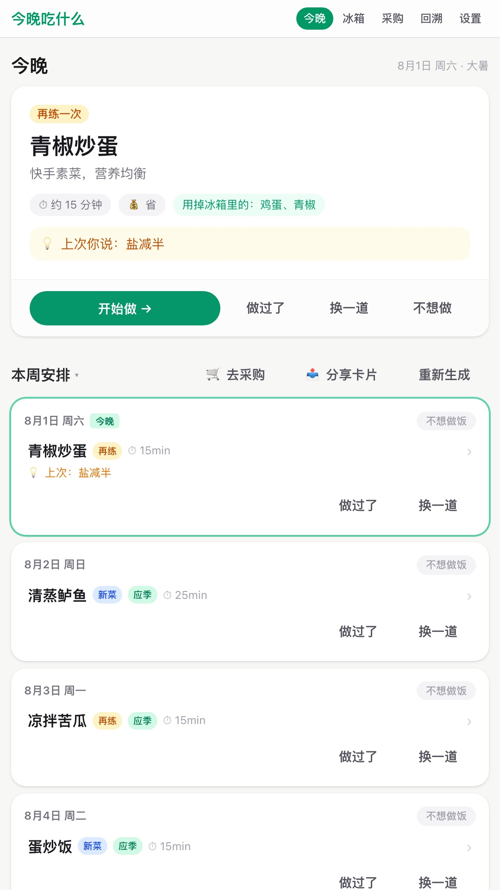
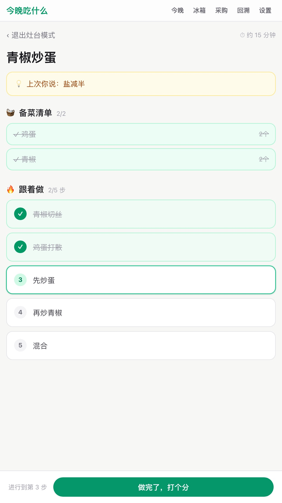
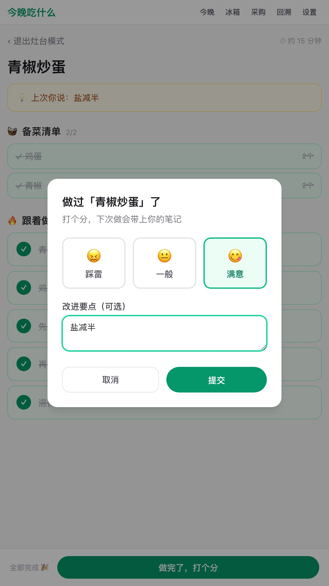
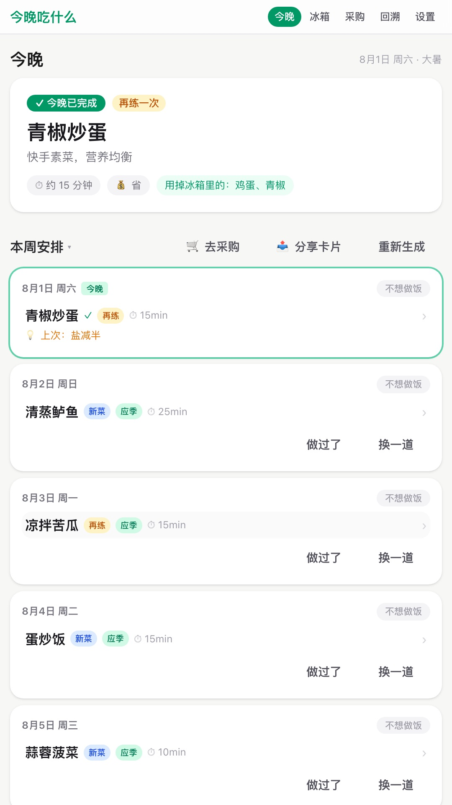
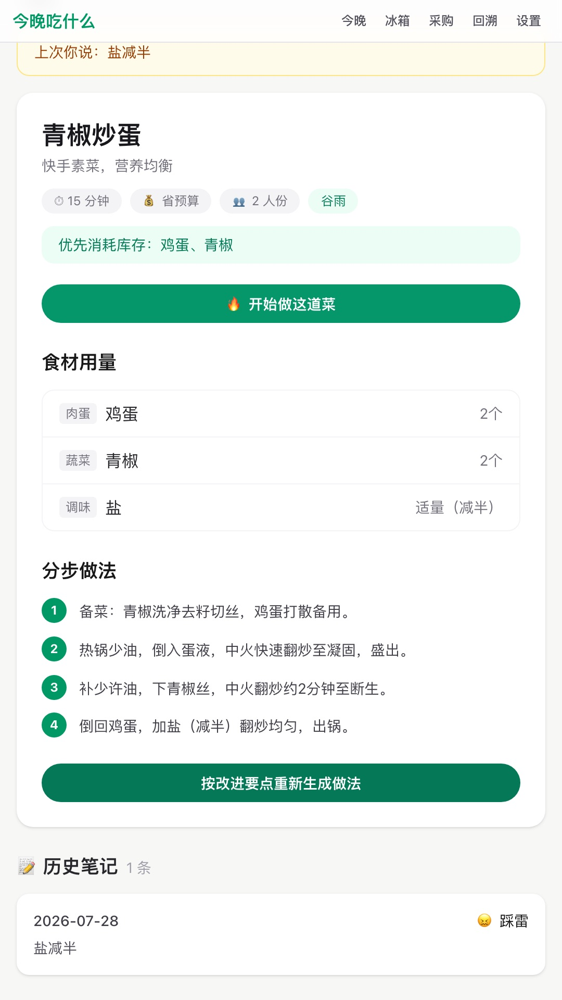
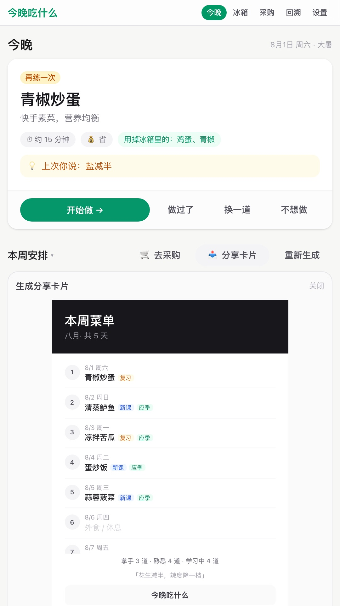

<p align="center">
  
</p>

<h1 align="center">今晚吃什么</h1>

<p align="center"><strong>今晚这道菜，正当时</strong></p>

<p align="center">
  
  
  
</p>

## 演示视频（60 秒）

[](https://github.com/black-pupil153/wha2eat/releases/tag/v1.0.0)

- 完整视频（可下载）：[GitHub Release](https://github.com/black-pupil153/wha2eat/releases/tag/v1.0.0) · [飞书云盘](https://my.feishu.cn/file/Jos0b6vyyohAQkxoj0ScsRnOnwg)（国内秒开）
- 视频主线：`?demo=1` 进入演示 → 今晚卡片点开 → 灶台模式带做 → 做完评分 → 按笔记修订菜谱 → 分享卡片导出

## 线上体验

**[http://43.143.48.9:3000](http://43.143.48.9:3000)** — 腾讯云轻量，国内直连

加 `?demo=1` 可一键进入预置演示态（自动写入偏好、冰箱、菜谱库与做饭历史，无需本地配置）：

**[http://43.143.48.9:3000/?demo=1](http://43.143.48.9:3000/?demo=1)**

备用部署：[https://wha2eat.vercel.app](https://wha2eat.vercel.app)

## 它解决什么问题

- **想吃什么太耗神** — 每天下班还要在 App 里翻半天，决策成本比做菜还高
- **菜谱不会积累** — 收藏夹越堆越多，做过的改进要点散落各处，下次还是照网上抄
- **做菜没成就感** — 做完就忘，没有「越练越熟」的反馈，很难形成自己的拿手菜

## 核心体验

| | |
|---|---|
|  | **打开就是今晚这道菜** — 首页直接给出今晚推荐，急消耗、节气、复习与新菜按规则排好，不用先规划再决定 |
|  | **灶台模式一步步带做** — 备菜勾选、步骤逐条完成，上次改进笔记顶栏可见，降低开火后的心智负担 |
|  | **评分笔记让菜谱进化** — 「做过了」统一评分入口，改进要点写回菜谱库，DeepSeek 按笔记修订做法 |

## 更多能力

| | |
|---|---|
|  | **节气应季** — 廿四节气推今晚该吃的菜，库内占槽节气优先于复习到期；**掌握度回溯** — 做过的菜按掌握度自动排期到期再练 |
|  | **采购清单** — 菜单食材减冰箱库存得待购项，同类合并、勾选状态保留，「建议多买」囤货标签；一键入库联动 |
|  | **分享卡片** — 导出 3:4 竖版 PNG（新课 / 复习 / 应季 + 掌握度），可直接发小红书 |

## 技术栈

- **框架**：Next.js App Router + TypeScript + Tailwind CSS
- **状态与持久化**：React Context（`AppProvider`）+ 浏览器 localStorage
- **LLM**：DeepSeek API（`deepseek-chat`），仅用于候选不足补位与按笔记修订做法
- **菜谱底库**：本地 HowToCook 精选 **124 道**（`src/data/catalog.json`，Unlicense），规则选菜秒出；LLM 不做主路径生成

## 本地运行

```bash
pnpm install
cp .env.example .env.local   # 填入 DEEPSEEK_API_KEY
pnpm dev
```

API Key 获取：[DeepSeek 开放平台](https://platform.deepseek.com/) → API Keys

---

<p align="center">
  外滩黑客松 AI Coding 大赛 × Qoder 赛道 · Web/H5 参赛作品
</p>
